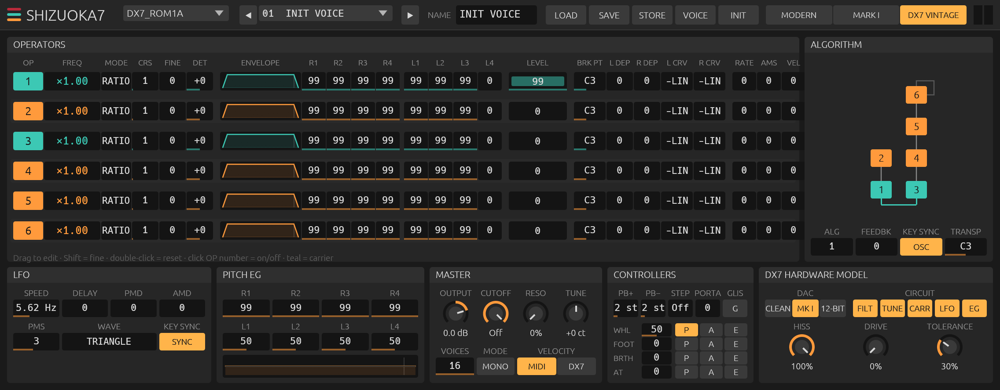

# SHIZUOKA7

**Six operators, thirty-two algorithms, one slightly noisy 12-bit DAC. By Jardim Sonoro.**

> 静岡 · Shizuoka Prefecture, Japan. Green tea, a view of Mount Fuji, and
> Hamamatsu - the city where Yamaha, Kawai and (these days) Roland all keep
> their headquarters. For a few years in the 1980s, the sound of pop music
> was decided there.



## 1983, a brown box, and the end of the analog decade

In May 1983 a company from Hamamatsu put a brown slab with green membrane
buttons in the shops. It had no knobs. It had a two-line LCD, a manual
nobody finished, and an idea licensed from a Stanford professor: make
sound by having sine waves bully each other at audio rate. It cost about a
third of what a serious polysynth did, it was sixteen-voice polyphonic, it
stayed in tune, and it could do glassy electric pianos, rubber basses and
bells that no analog machine had ever managed.

Within a couple of years it was on *everything*. The electric piano on
every power ballad. The bass on "Take On Me". The *Twin Peaks* theme. It
sold in six figures, emptied the second-hand market of Rhodes pianos, and
kicked off the golden age of Japanese digital instruments: phase
distortion from Tokyo, linear arithmetic from Osaka, PCM workstations,
rack modules with one-character displays, and breath controllers that made
keyboard players look like they were vaping in 1985.

Almost nobody programmed it. People bought ROM cartridges, pressed button
11, and went to the studio. That is fine. That is tradition.

**Shizuoka7 is a love letter to that machine** - and a slightly obsessive
one. It is a free, non-commercial study in hardware simulation: the
[Dexed](https://github.com/asb2m10/dexed) FM engine ported to Rust with the
[truce](https://github.com/truce-audio/truce) plugin framework, plus a
model of everything the original Mark I does to the sound *after* the
maths is over: the 49.096 kHz clock, the envelope chip that moves in tiny
stairs, the gain-ranged 12-bit converter whose noise floor breathes with
your playing, and an analog output filter that rings at 16 kHz after every
transient. The parts that made it sound like a piece of 1983 hardware
instead of a spreadsheet.

And unlike the original, the whole voice is on one screen. With a mouse.
You're welcome, 1983.

## What you get

- **AU**, **VST3**, **CLAP** on macOS (Apple Silicon); **VST3**, **CLAP** on
  Windows and Linux (x64)
- **1312 voices built in**: all eight factory ROM cartridges (yes, E.PIANO 1
  is exactly where you left it) and the 33 banks Dexed ships with
- Reads and writes real SysEx: 32-voice cartridges and single voices, so
  forty years of patch archives just load
- Every voice parameter is an automatable host parameter with real units
- Three engines: clean modern FM, chip-accurate Mark I, and **DX7 Vintage**
  with the full hardware model (the default, obviously)
- About 1 % of one CPU core for sixteen voices. The original needed two
  custom chips and a power supply the size of a lunchbox.

## Install

Grab the zip for your system from the
[latest release](https://github.com/nagualcode/shizuoka7/releases/latest)
and copy the plug-ins where your DAW looks for them:

| System | Zip | Copy to |
|---|---|---|
| macOS (Apple Silicon) | `Shizuoka7-<version>-macOS-arm64.zip` | `Shizuoka7.component` → `~/Library/Audio/Plug-Ins/Components/`, `Shizuoka7.vst3` → `~/Library/Audio/Plug-Ins/VST3/`, `Shizuoka7.clap` → `~/Library/Audio/Plug-Ins/CLAP/` |
| Windows (x64) | `Shizuoka7-<version>-Windows-x64.zip` | `Shizuoka7.vst3` → `C:\Program Files\Common Files\VST3\`, `Shizuoka7.clap` → `C:\Program Files\Common Files\CLAP\` |
| Linux (x64) | `Shizuoka7-<version>-Linux-x64.zip` | `Shizuoka7.vst3` → `~/.vst3/`, `Shizuoka7.clap` → `~/.clap/` |

Rescan plug-ins and look under *Jardim Sonoro › Shizuoka7*. The builds come
from GitHub Actions and are not signed with a paid certificate, so macOS
may sulk; tell it everything is fine:

```sh
xattr -dr com.apple.quarantine ~/Library/Audio/Plug-Ins/Components/Shizuoka7.component
```

(same for the `.vst3` / `.clap`). The Windows and Linux builds pass the
same tests in CI but have not been tried in a DAW yet; reports welcome.


**From source** (needs Rust; on Linux the X11 / OpenGL / ALSA / JACK
development packages listed in `.github/workflows/build.yml`):

```sh
cargo install cargo-truce
cargo truce install        # builds and installs the plug-ins for this system
```

## Using it

### Header

| Control | What it does |
|---|---|
| Cartridge menu | The built-in banks: DX7_ROM1A..4B (Yamaha factory), Dexed_01, SynprezFM_01..32. A new instance opens on DX7_ROM1A. |
| ◀ program ▶ | Pick one of the cartridge's 32 voices. Changing preset (here, by MIDI program change, LOAD or INIT) fades out every sounding note in 5 ms, so nothing of the old sound keeps ringing. |
| NAME | The voice name (10 characters, saved with STORE / VOICE). |
| LOAD | Open a `.syx`: a cartridge replaces the bank, a single voice replaces the current voice. Checksum errors and raw (headerless) banks are accepted, as in Dexed. |
| SAVE | Write the current cartridge as a standard DX7 bulk dump. |
| STORE | Write the edited voice into the current cartridge slot. |
| VOICE | Export the current voice as a single-voice SysEx. |
| INIT | DX7 INIT VOICE. |
| MODERN / MARK I / DX7 VINTAGE | Sound engine, see below. |

MIDI program changes pick a voice from the current cartridge, and a
single-voice SysEx dump sent over MIDI is loaded. Pitch bend, mod wheel
(CC1), breath (CC2), foot (CC4), sustain (CC64) and channel pressure work
as on Dexed; their pitch / amp / EG-bias routing is in CONTROLLERS.

### Panel

- **Operators**: one row per operator, OP1 on top. Click the number to
  switch an operator off. Teal = carrier, orange = modulator in the
  current algorithm. Columns: frequency (ratio or fixed Hz), mode,
  coarse, fine, detune; envelope sketch and rates/levels; output level;
  keyboard level scaling (break point, depths, curves); rate scaling, amp
  mod sensitivity and velocity sensitivity.
- **Algorithm**: the operator graph with its feedback loop, drawn from the
  same routing table the engine uses; algorithm, feedback, oscillator key
  sync and transpose below it.
- **LFO**, **Pitch EG**, **Master** (output, Dexed's cutoff / resonance
  filter, tuning, voices, mono, velocity scale) and **Controllers**.
- **DX7 Hardware Model** (active with the DX7 VINTAGE engine): the DAC
  mode, switches for the parts of the hardware model (FILT, TUNE, CARR,
  LFO, EG) and the HISS / DRIVE / TOLERANCE amounts.

Drag to change, Shift-drag for fine steps, double-click to reset, mouse
wheel for single steps.

## Engines

| Engine | What it is |
|---|---|
| **Modern** | Dexed's "Modern" core (msfa): high-resolution sine, linear gain, host sample rate. FM as the textbook describes it. |
| **Mark I** | Dexed's default engine: log-sine / exp tables like the OPS chip, at the host sample rate, without the hardware model. Sounds like Dexed. |
| **DX7 Vintage** (default) | The Mark I core plus the hardware model below. Sounds like a brown box. |

The **DAC** selector (DX7 Vintage only) picks the converter:

| DAC | What it is |
|---|---|
| **Clean** | No converter at all: the rest of the hardware model without the grain or the converter noise. |
| **Mk I** (default) | The Mark I converter: 12-bit with an analog gain stage, per voice. |
| **12-bit** | Linear 12-bit without gain ranging. No DX7 did this; a lo-fi comparison. |

"Mark I" means two things here: the engine button is Dexed's name for its
chip-accurate core, the DAC mode is the converter of the original DX7
(as opposed to the DX7 II).

### The hardware model

What software usually leaves out, based on die photos of the YM21280 OPS
chip (Ken Shirriff), the VDX7 firmware-level emulator, the annotated v1.8
firmware and Yamaha's patents. Where the sources run out the model makes
a best-effort guess in favour of the hardware, and says so. Decisions and
evidence are in [`docs/HARDWARE.md`](docs/HARDWARE.md), the full research
notes in [`docs/RESEARCH.md`](docs/RESEARCH.md).

| Part | What the hardware does | In Shizuoka7 |
|---|---|---|
| Clock | 9.4265 MHz / 192 = **49,096 Hz**. FM aliasing folds around 24.55 kHz, so the inharmonic alias tones land where they do on the real unit. | The FM core runs at 49,096 Hz and is resampled to the host rate. |
| Envelopes (**EG**) | The EGS chip steps a 12-bit attenuation **every sample**, in whole units (0.0235 dB), from one shared counter. Fast attacks land within a millisecond; slow decays are a fine staircase; two low levels in a row become the famous envelope "delay". | A port of the chip's envelope (after VDX7 / MSFA), no interpolation. Decay rates match the published measurements within 3 %; Dexed's block envelope is about 11 % slower and cannot attack faster than 1.3 ms. |
| Carrier scaling (**CARR**) | Each carrier is attenuated by log2(number of carriers) before the exp lookup. Six-carrier algorithms are 15.8 dB quieter per carrier, and a carrier's own feedback is weaker (why Dexed's algorithm 32 feedback is "too strong"). | Applied exactly where the chip does it. |
| DAC | Each voice is converted on its own: a 15-bit word into a 12-bit BA9221 shifted by 0-3 bits, then an analog /1../8 scaler: sign + 11-bit mantissa + 2-bit exponent. The grain rises and falls with each voice's level. | Per voice, on the chip's own word scale (a level-99 carrier peaks at half of full scale), then summed as the analog side does. |
| Converter noise (**HISS**) | The scaler sits *after* the DAC, so the DAC's noise is turned down with quiet voices and up with loud ones: the noise floor breathes with the playing and steps down as notes decay. | Converter noise scaled by every voice slot's range, plus constant op-amp hiss. Levels are estimates (no published measurement). |
| DAC linearity (**TOLERANCE**) | A 12-bit R-2R converter has bit-weight errors, biggest at the major carry - which in two's complement is the zero crossing. The scaler brings quiet voices back to the full code range, so the crossover grit follows the signal down. The scaler's 0.1 % resistors add gain steps between ranges. | One fixed "unit" of bit and ladder errors, scaled by TOLERANCE (default 30 %, about a healthy unit; 0 = ideal converter). High settings add a small fixed detune per voice. |
| Sample-and-hold | Two hold capacitors take the 16 voice slots in turn: each voice sits at the filter input for an eighth of a sample. No audible droop. | In the resampling kernel (0.02 dB at 15 kHz). |
| Output filter (**FILT**) | Passive pole + two Sallen-Key stages, 5th order: 6.8 kHz, 11.6 kHz Q 1.02, 16.1 kHz Q 4.13 - flat to 5 kHz, +0.8 dB at 15 kHz, -3 dB at 17 kHz, -14 dB at 20 kHz. Being analog, it rings *after* a transient, never before. | The circuit's complex transfer function is built into the resampler: magnitude within 0.5 dB and the true causal phase at 44.1, 48 and 96 kHz. |
| Tuning (**TUNE**) | Pitch is 1024 steps/octave (1.17 cents). The 2nd and 3rd semitone of each minor third are 0.39 and 0.78 cents flat. Ratios are rounded log values: x5 is +0.41 cents, x11 is -0.54 cents, so "harmonic" partials slowly beat. | Firmware coarse/fine/fixed tables and the key-code pattern; A4 stays 440 Hz. |
| LFO (**LFO**) | The firmware updates LFO and modulation at ~372 Hz: fast vibrato is audibly stepped. | LFO held for 2 blocks (128 samples) at 49.1 kHz. |
| Drive | - | Optional output op-amp soft clip (0 = off). Not a hardware fact, just fun. |

**Not modelled yet**: the 32-step velocity quantisation of the MIDI input,
the one-bit uncertainty of the feedback shift, the EGS detune law (Dexed's
measured curve is used), the firmware's amplitude-modulation law and the
186 Hz pitch-EG steps. A recording of a real unit would settle most of
them; if you own one, get in touch.

## Press button 11

The eight factory ROM cartridges hold the presets heard on countless 80s
records. Some well-documented uses (from Reverb Machine's song analyses):

| Song | Voice |
|---|---|
| Whitney Houston, "Saving All My Love for You", "Greatest Love of All"; *Twin Peaks* theme | DX7_ROM1A 11 **E.PIANO 1** |
| a-ha, "Take On Me" (bass) | DX7_ROM1A 15 **BASS 1**, add chorus |
| a-ha, "Take On Me" (lead, layered with a Juno-60) | DX7_ROM2B 02 **SYN-LEAD 3** |
| Berlin, "Take My Breath Away" | DX7_ROM1A 16 **BASS 2** |
| Tina Turner, "What's Love Got to Do With It" | ROM1A **BASS 1**, ROM1B **CALIOPE**, an edited ROM1A **FLUTE 1** |
| Queen, "Who Wants to Live Forever" | DX7_ROM2B 14 **SYN-ORCH** |

Many records used these presets with studio effects (chorus, delay,
reverb); add them in the DAW.

All 228 banks of Dave Benson's DX7 archive (7296 voices) load and render
with `cargo run --release --example syx_info -- *.syx`.

## Preset compatibility

Shizuoka7 reads anything Dexed reads: `.syx` cartridges (also with a
performance dump before the voice dump, checksum mismatches, or raw 4096
byte banks) and single voices. Unpacking follows Dexed's
`Cartridge::unpackProgram`, including its rescaling of out-of-range bytes.
Saved banks are standard DX7 bulk dumps that load in Dexed and on the
hardware (through any SysEx tool).

## Build and test

```sh
cargo test --release                              # 24 DSP, SysEx and plugin tests
cargo test --release --features rt-paranoid       # also flags audio-thread allocation
cargo run --release --example render -- 0 13 2 60 out.wav 3   # cart, voice, engine, note
cargo run --release --example bench               # CPU use per engine
cargo truce validate                              # auval, pluginval, clap-validator
```

Source map: `src/dx7/` - `tables.rs` (sine/exp/log-sine tables), `env.rs`
(Dexed's block envelope and the per-sample EGS envelope), `lfo.rs`,
`note.rs` (voice, pitch, hardware tuning), `core.rs` (algorithms, Modern
and Mark I kernels, carrier scaling), `synth.rs` (voice allocation,
per-voice DAC), `resample.rs` (49.1 kHz to host, S&H + output filter),
`vintage.rs` (analog stage), `fx.rs` (Dexed's filter). `src/sysex.rs`
(cartridges), `src/params.rs` (generated by `tools/gen_params.py`),
`src/ui/` (editor).

## Credits and license

- FM engine ported from **Dexed** by Pascal Gauthier (GPL-3.0) and **msfa**
  by Raph Levien / Google (Apache-2.0).
- EGS envelope after **VDX7** by chiaccona (GPL-3.0).
- Built-in cartridges: the Yamaha DX7 factory ROM cartridges 1A-4B
  (voice data © Yamaha Corporation, as archived on Dave Benson's DX7
  page), and the banks distributed with Dexed (Dexed_01 and SynprezFM
  01-32).
- Hardware research: Ken Shirriff's YM21280 die analysis, VDX7, the ajxs
  DX7 firmware disassembly, Raph Levien's MSFA notes, Yamaha patents
  US 4,554,857, 4,249,447, 4,539,883.
- Plugin framework: truce (MIT/Apache-2.0).
- DX7 is a trademark of Yamaha Corporation. Shizuoka7 is an independent,
  non-commercial project, not affiliated with or endorsed by Yamaha or
  any other company mentioned here. It is named after a place, with
  affection.

Shizuoka7 is licensed under **GPL-3.0-or-later**.
